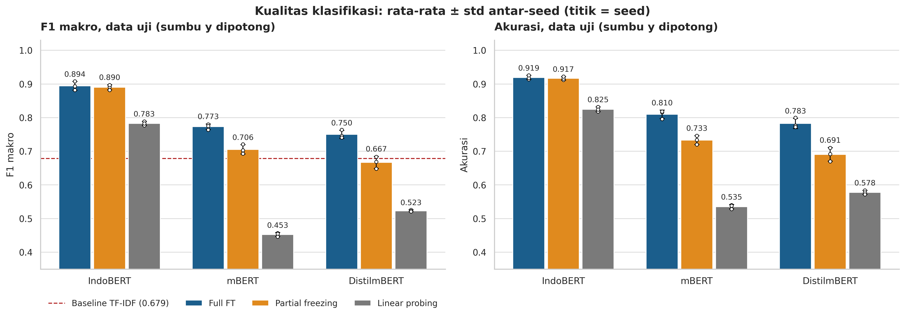
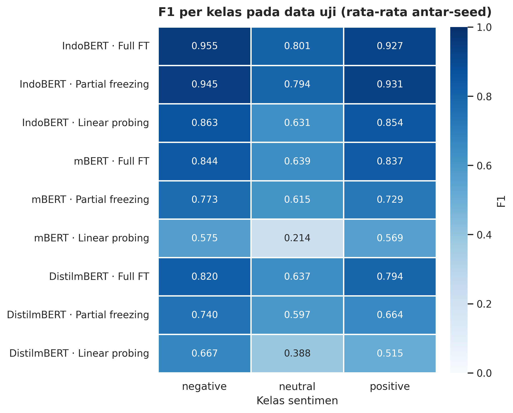
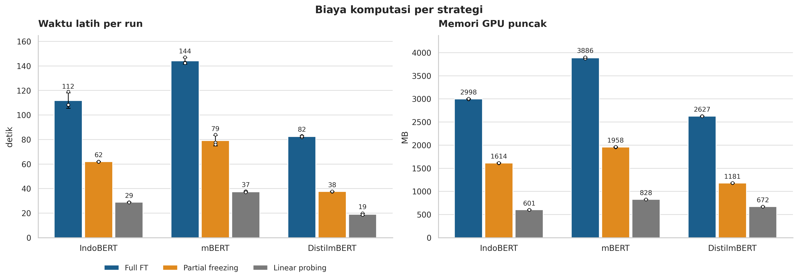
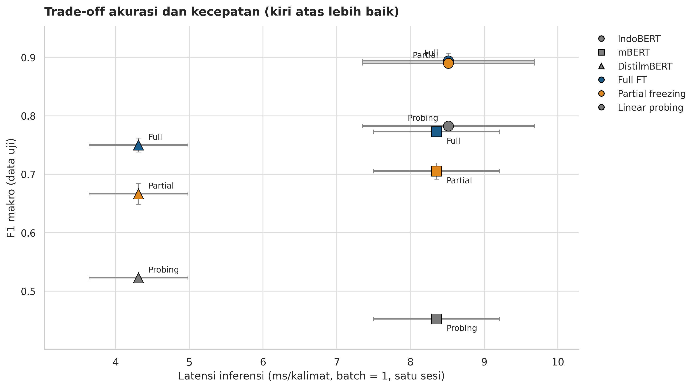

<!-- _class: lead -->
# Studio Proyek 3: Pembelajaran Mendalam
## Fine-Tuning Transformer Pretrained untuk Analisis Sentimen Bahasa Indonesia (SmSA)
### Analisis Komparatif 3 Backbone × 3 Strategi Berbasis Trade-off Performa & Efisiensi Komputasi

**Kelompok 11 — Kelompok Yolo**
- **Sigit Kurnia Hartawan** (NIM: `123140033`)
- **Muhammad Romadhon Santoso** (NIM: `123140031`)

*Teknik Informatika — Institut Teknologi Sumatera (ITERA)*
*Semester Ganjil 2026/2027*

<!-- Speaker Note:
Selamat pagi/siang bapak/ibu dosen dan rekan-rekan. Kami dari Kelompok 11 (Kelompok Yolo) mempresentasikan hasil Studio Proyek 3 mengenai fine-tuning Transformer pretrained pada dataset SmSA Bahasa Indonesia. Kami membandingkan 3 model backbone dan 3 strategi fine-tuning dalam 27 run terkendali untuk menguji trade-off nyata antara akurasi, biaya latih GPU, dan latensi inferensi.
-->

---

## 1. Latar Belakang, Dataset & Rancangan Terkendali

  

    <h4>Dataset SmSA (IndoNLU Benchmark)</h4>
    <ul>
      <li>Klasifikasi 3 kelas: <b>Positive (58.4%)</b>, <b>Negative (31.2%)</b>, dan <b>Neutral (10.4%)</b>.</li>
      <li><b>Metrik Primer:</b> <b>Macro F1-Score</b> (karena ketimpangan kelas; kelas netral adalah minoritas).</li>
      <li><b>Protokol Subset Resmi:</b>
        <ul>
          <li>Data Latih: <b>5.000 sampel</b> (berstrata, rentang 3.000–6.000).</li>
          <li>Data Validasi: <b>1.246 sampel</b> (hanya memilih best epoch).</li>
          <li>Data Uji: <b>500 sampel resmi</b> (disentuh 1× per run).</li>
        </ul>
      </li>
      <li>Pembersihan data: 0 konflik, 67 duplikat, 14 kebocoran dibuang.</li>
    </ul>
  

  

    <h4>Desain Matriks 27 Run Terkendali</h4>
    
<b>3 Backbone × 3 Strategi × 3 Random Seed (42, 123, 2024)</b>

    

      <b>Variabel Terkunci Sepanjang Eksperimen:</b>
      <ul>
        <li><b>Batch Size:</b> 32 (diseragamkan seluruh run)</li>
        <li><b>Max Length:</b> 128 token (dinamis per batch)</li>
        <li><b>Epochs:</b> 4 epoch (checkpoint terbaik via Val F1)</li>
        <li><b>Optimizer:</b> AdamW ($wd = 0.01$, warmup linear 10%)</li>
        <li><b>Presisi:</b> Automatic Mixed Precision (AMP FP16)</li>
        <li><b>Latensi Benchmark:</b> Batch=1, FP32, 1 sesi T4.</li>
      </ul>
    

  

  <b>Tujuan Penelitian:</b> Membuktikan model mana yang memberikan trade-off paling rasional antara akurasi, waktu komputasi, dan kecepatan respon inferensi untuk kebutuhan industri nyata.

<!-- Speaker Note:
Sesuai Soal 1, rancangan eksperimen kami susun sebelum menulis kode. Kami menggunakan dataset resmi SmSA IndoNLU dengan protokol pembersihan anti-leakage yang ketat. Data latih dibatasi pada subset berstrata 5.000 sampel, data validasi 1.246 sampel hanya untuk memilih best epoch, dan data uji resmi 500 sampel hanya dievaluasi sekali pada akhir tiap run. Seluruh variabel operasional kami kunci pada matriks 27 run.
-->

---

## 2. Arsitektur Model Backbone & Strategi Fine-Tuning

  

    <h4>3 Model Backbone Pretrained</h4>
    <ul>
      <li><b>IndoBERT (<code>indobenchmark/indobert-base-p1</code>)</b>
         <small>12 lapis, 124.4M parameter. Arsitektur monolingual yang dilatih khusus pada korpus teks Bahasa Indonesia (Indo4B).</small>
      </li>
      <li><b>mBERT (<code>bert-base-multilingual-cased</code>)</b>
         <small>12 lapis, 177.9M parameter. Baseline pembanding global (dilatih bersama pada 104 bahasa dunia).</small>
      </li>
      <li><b>DistilmBERT (<code>distilbert-base-multilingual</code>)</b>
         <small>6 lapis, 135.3M parameter. Versi kompresi distilasi pengetahuan berorientasi efisiensi komputasi.</small>
      </li>
    </ul>
  

  

    <h4>3 Strategi Pembekuan Lapisan (Freezing)</h4>
    <ul>
      <li><b>Full Fine-Tuning (Baseline):</b>
         Seluruh bobot backbone dan classification head dilatih (100% parameter trainable). LR = $3 \times 10^{-5}$.
      </li>
      <li><b>Partial Freezing:</b>
         Embedding + 6 layer awal BERT dibekukan (3 layer pada DistilBERT). Parameter dilatih: 16%–35%. LR = $3 \times 10^{-5}$.
      </li>
      <li><b>Linear Probing:</b>
         Backbone dibekukan 100%, hanya classification head baru yang dilatih. Parameter: < 0.5%. LR disesuaikan ke $3 \times 10^{-3}$.
      </li>
    </ul>
  

  <b>Ketentuan Head Replacement:</b> Seluruh 27 run mengganti layer classifier bawaan dengan head klasifikasi 3 kelas (Positive, Negative, Neutral).

<!-- Speaker Note:
Sesuai Soal 2 dan 3, kami menguji 3 backbone dan 3 strategi fine-tuning. Head replacement diterapkan di seluruh run. Pada partial freezing, separuh layer awal dibekukan untuk menghemat backpropagation. Pada linear probing, seluruh backbone dibekukan dan learning rate dinaikkan ke 3e-3 agar head baru dapat teroptimasi cepat.
-->

---

## 3. Rekapitulasi Hasil Agregat (Mean ± SD dari 27 Run)

Pengujian pada **data uji resmi SmSA (500 kalimat)** dengan kode konfigurasi **`94fade`** (Tesla T4 GPU):

| Model Backbone | Strategi | Akurasi | Macro F1 | F1 Neutral | Waktu Latih (s) | Memori (MB) | Latensi (ms) | Param Dilatih |
|:---|:---|:---:|:---:|:---:|:---:|:---:|:---:|:---:|
| **IndoBERT** | **Full** | **0.9193 ± 0.006** | **0.8942 ± 0.013** | **0.7812 ± 0.038** | 111.8 ± 6.3 | 2998.4 MB | 8.51 ± 1.17 | 124.4M (100%) |
| IndoBERT | Partial | 0.9167 ± 0.005 | 0.8901 ± 0.007 | 0.7715 ± 0.021 | 61.9 ± 0.2 | 1613.8 MB | 8.51 ± 1.17 | 43.1M (34.7%) |
| IndoBERT | Probing | 0.8247 ± 0.007 | 0.7826 ± 0.006 | 0.5878 ± 0.025 | 28.9 ± 0.1 | 601.2 MB | 8.51 ± 1.17 | 2.3K (0.002%) |
| **mBERT** | Full | 0.8100 ± 0.012 | 0.7730 ± 0.008 | 0.6015 ± 0.022 | 144.1 ± 2.6 | 3886.0 MB | 8.35 ± 0.86 | 177.9M (100%) |
| mBERT | Partial | 0.7333 ± 0.013 | 0.7055 ± 0.014 | 0.5284 ± 0.027 | 79.2 ± 4.3 | 1957.8 MB | 8.35 ± 0.86 | 43.1M (24.2%) |
| mBERT | Probing | 0.5353 ± 0.006 | 0.4527 ± 0.006 | 0.2486 ± 0.018 | 37.4 ± 0.5 | 827.6 MB | 8.35 ± 0.86 | 2.3K (0.001%) |
| **DistilmBERT** | Full | 0.7827 ± 0.015 | 0.7501 ± 0.012 | 0.5732 ± 0.034 | 82.4 ± 0.5 | 2626.9 MB | **4.31 ± 0.67** | 135.3M (100%) |
| DistilmBERT | Partial | 0.6907 ± 0.020 | 0.6668 ± 0.018 | 0.4907 ± 0.038 | 37.6 ± 0.1 | 1180.6 MB | **4.31 ± 0.67** | 21.9M (16.2%) |
| DistilmBERT | Probing | 0.5780 ± 0.006 | 0.5231 ± 0.003 | 0.3204 ± 0.021 | **19.0 ± 0.7** | **672.1 MB** | **4.31 ± 0.67** | 592.9K (0.44%) |

*Pembanding Sah:* Baseline TF-IDF + Logistic Regression = **0.6786**; Tebakan Acak = **0.3054**.

  <b>Sorotan Utama:</b> IndoBERT Full meraih Macro F1 tertinggi (<b>0.8942</b>). IndoBERT Partial mempertahankan <b>99.5% performa</b> dengan hemat waktu latih <b>44.6%</b> dan hemat memori <b>46.2%</b>.

<!-- Speaker Note:
Tabel ini memuat hasil agregat 27 run pada data uji resmi. Tiga temuan penting: IndoBERT unggul mutlak atas model multilingual; IndoBERT Partial mempertahankan 99.5% F1 Full dengan waktu latih separuh; dan DistilmBERT memangkas latensi inferensi hingga 4.31 ms.
-->

---

## 4. Analisis Kualitas Model & Ketahanan Kelas Minoritas

  

    
    
<b>Grafik 1:</b> Perbandingan Akurasi & Macro F1 pada Data Uji

    <ul>
      <li><b>IndoBERT Memimpin Mutlak:</b> F1 IndoBERT Full (**0.8942**) unggul **+12.11 poin** di atas mBERT dan **+14.40 poin** di atas DistilmBERT.</li>
      <li><b>Penurunan Multilingual:</b> Probing pada mBERT (0.4527) dan DistilmBERT (0.5231) jatuh jauh di bawah baseline TF-IDF (0.6786).</li>
    </ul>
  

  

    
    
<b>Grafik 4:</b> Performa F1 per Kelas Sentimen

    <ul>
      <li><b>Kelas Netral (10.4%) Jadi Pembeda:</b> IndoBERT Full meraih F1 Netral tertinggi (**0.7812**) vs mBERT (0.6015) & Distil (0.5732).</li>
      <li><b>Keruntuhan Probing Multilingual:</b> mBERT Probing ambruk di kelas netral (F1 hanya **0.2486**) akibat kegagalan fitur beku menangkap nuansa lokal.</li>
    </ul>
  

<!-- Speaker Note:
Grafik 1 dan 4 memperlihatkan keunggulan representasi monolingual. Pada kelas netral yang merupakan minoritas paling sulit, IndoBERT unggul jauh. Ketika backbone dibekukan penuh (linear probing), fitur representasi mBERT kolaps di kelas netral hingga F1 hanya 0.2486, membuktikan representasi umumnya tidak cukup peka terhadap konteks lokal.
-->

---

## 5. Analisis Efisiensi Komputasi & Trade-off Latensi

  

    
    
<b>Grafik 2:</b> Waktu Pelatihan & Konsumsi Memori GPU

    <ul>
      <li><b>Efisiensi Partial Freezing:</b> Memangkas waktu latih **44.6%–54.4%** dan memori GPU **46.2%–55.1%** di seluruh backbone.</li>
      <li><b>IndoBERT Lebih Hemat dari mBERT:</b> IndoBERT Full melatih parameter 30% lebih sedikit (124M vs 178M), 22% lebih cepat dan 23% lebih hemat VRAM.</li>
    </ul>
  

  

    
    
<b>Grafik 3:</b> Kurva Trade-off Macro F1 vs Latensi Inferensi

    <ul>
      <li><b>Freezing $\neq$ Inferensi Cepat:</b> Pembekuan lapisan hanya menghemat waktu training, tidak mengubah latensi (forward pass tetap sama).</li>
      <li><b>Latensi Murni Distilasi:</b> DistilmBERT memangkas latensi hingga **4.31 ms/kalimat** (hemat 48.4%), tetapi mengorbankan 14.40 poin F1.</li>
    </ul>
  

<!-- Speaker Note:
Grafik 2 dan 3 memperlihatkan insight arsitektural penting: pembekuan layer sangat efektif memangkas waktu latih dan konsumsi VRAM, tetapi sama sekali TIDAK mempercepat inferensi. Kecepatan inferensi murni ditentukan oleh arsitektur model, di mana DistilmBERT 6 lapis mampu mencapai latensi 4.31 ms.
-->

---

## 6. Pengujian Statistik Hipotesis Penelitian (H1–H3)

Evaluasi formal hipotesis desain berdasarkan hasil empiris 27 run:

| Hipotesis | Pengujian & Klaim Desain | Bukti Empiris Terukur | Status |
|:---:|:---|:---|:---:|
| **H1** | IndoBERT Full Fine-Tuning mengungguli mBERT dan DistilmBERT secara signifikan | Selisih F1 vs mBERT: **+12.11 poin** ($p = 0.0005$) Selisih F1 vs Distil: **+14.40 poin** ($p = 0.0002$) Selisih jauh melampaui simpangan baku maksimum ($SD \le 1.30$) | TERDUKUNG |
| **H2** | DistilmBERT menghemat waktu latih & latensi $\ge 35\%$ vs mBERT dengan penurunan F1 $\le 3$ poin | Hemat waktu latih: **42.8%** (144.1s → 82.4s) Hemat latensi inferensi: **48.4%** (8.35ms → 4.31ms) Penurunan Macro F1: hanya **2.29 poin** (di bawah batas 3.0 poin) | TERDUKUNG |
| **H3** | Hierarki: Full $\ge$ Partial > Probing; Partial mempertahankan $\ge 96\%$ performa Full dengan hemat biaya $\ge 40\%$ | Hierarki performa terbukti konsisten di seluruh model. Hemat waktu (44.6%–54.4%) & memori (46.2%–55.1%) > 40%. Namun retensi F1 $\ge 96\%$ **hanya tercapai di IndoBERT (99.5%)**, sedangkan mBERT (91.3%) & Distil (88.9%) gagal. | BERSYARAT |

<small>*Uji signifikansi: Two-sample Welch's t-test antar-seed acak ($p < 0.05$).</small>

<!-- Speaker Note:
Hasil evaluasi statistik menunjukkan H1 dan H2 terdukung penuh. H3 terdukung secara bersyarat: efisiensi biaya > 40% tercapai di semua model, namun retensi performa 96% hanya berhasil dipenuhi oleh IndoBERT (99.5%). Pada model multilingual, membekukan layer awal membuang kapasitas adaptasi yang dibutuhkan.
-->

---

## 7. Jawaban Pertanyaan Riset Wajib: Q1 & Q2

  

    <h4>Q1: Backbone Terbaik (Trade-off)</h4>
    
<b>Pemenang: IndoBERT (<code>indobert-base-p1</code>)</b>

    <ul>
      <li><b>Macro F1 ± SD:</b> <b>0.8942 ± 0.0130</b> (Akurasi 0.9193).</li>
      <li><b>Waktu Latih:</b> <b>111.8 detik</b> (22.4% lebih cepat dari mBERT 144.1s).</li>
      <li><b>Konsumsi Memori:</b> <b>2.998 MB</b> (22.8% lebih hemat dari mBERT 3.886 MB).</li>
      <li><b>Latensi Inferensi:</b> <b>8.51 ± 1.17 ms/kalimat</b> (~117 kalimat/detik).</li>
      <li><b>Parameter Total:</b> <b>124.4M</b> (vs mBERT 177.9M).</li>
    </ul>
    
<small><b>Alasan:</b> Unggul +12.11 s.d. +14.40 poin F1 secara signifikan berkat kecocokan korpus monolingual Indonesia, sekaligus lebih hemat komputasi dibanding mBERT.</small>

  

  

    <h4>Q2: Kompetitivitas Strategi Hemat</h4>
    
<b>Kompetitif HANYA pada IndoBERT, GAGAL pada Multilingual</b>

    <ul>
      <li><b>IndoBERT Partial:</b> F1 <b>0.8901 ± 0.0074</b> (tertinggal hanya <b>0.41 poin</b> dari Full). Selisih 0.41 < SD 1.30 poin ($p = 0.67$), <b>secara statistik setara</b> dengan hemat waktu <b>44.6%</b> dan hemat VRAM <b>46.2%</b>.</li>
      <li><b>mBERT & Distil Partial:</b> Tertinggal 6.75 & 8.34 poin (> SD maks), <b>beda bermakna</b>.</li>
      <li><b>Linear Probing:</b> Hemat waktu > 74%, tetapi anjlok parah (tertinggal 11–32 poin). Probing mBERT & Distil bahkan di bawah baseline TF-IDF.</li>
    </ul>
  

<!-- Speaker Note:
Untuk Q1, IndoBERT adalah pemenang mutlak karena unggul signifikan di akurasi sekaligus lebih hemat dari mBERT. Untuk Q2, strategi hemat komputasi hanya kompetitif pada IndoBERT melalui partial freezing (hanya beda 0.41 poin, secara statistik setara), sedangkan pada model multilingual strategi hemat komputasi gagal bersaing.
-->

---

## 8. Jawaban Pertanyaan Riset Wajib: Q3 & Rekomendasi Industri

Berdasarkan batas toleransi keputusan yang ditetapkan (lolos status wajar > TF-IDF 0.6786, toleransi penurunan F1 $\le 2$ poin skenario B dan $\le 4$ poin skenario C):

  

    <h4>Skenario A: Akurasi Utama</h4>
    
<b>IndoBERT Full Fine-Tuning</b>

    <ul>
      <li><b>Performa:</b> F1 <b>0.8942 ± 0.0130</b>, Akurasi <b>0.9193</b>.</li>
      <li><b>Biaya:</b> Latih 111.8s, VRAM 2.998 MB.</li>
      <li><b>Rasional:</b> Akurasi tertinggi tanpa kompromi; tepat untuk analisis sentimen opini hukum atau eskalasi komplain darurat VIP.</li>
    </ul>
  

  

    <h4>Skenario B: Anggaran Latih</h4>
    
<b>IndoBERT Partial Freezing</b>

    <ul>
      <li><b>Performa:</b> F1 <b>0.8901 ± 0.0074</b> (beda 0.41 poin; setara statistik).</li>
      <li><b>Biaya:</b> <b>Latih 61.9s (-44.6%)</b>, <b>VRAM 1.614 MB (-46.2%)</b>.</li>
      <li><b>Rasional:</b> <b>Rekomendasi Utama Kelompok.</b> Efisiensi biaya 2× lipat untuk pipeline retraining berkala.</li>
    </ul>
  

  

    <h4>Skenario C: Inferensi Cepat</h4>
    
<b>IndoBERT Full / Partial</b>

    <ul>
      <li><b>Performa:</b> Latensi <b>8.51 ms/kalimat</b> (~117 req/s per worker).</li>
      <li><b>Rasional:</b> DistilmBERT tidak dipilih karena F1-nya turun 14.40 poin (melebihi toleransi 4 poin). Latensi 8.51 ms sudah memadai untuk sistem produksi nyata.</li>
    </ul>
  

<!-- Speaker Note:
Untuk Q3, rekomendasi utama kami untuk industri adalah IndoBERT Partial Freezing. Konfigurasi ini memberikan akurasi yang setara dengan Full Fine-Tuning (selisih hanya 0.41 poin) tetapi memangkas biaya komputasi dan memori hingga hampir separuhnya. Untuk skenario inferensi cepat, kami tetap merekomendasikan IndoBERT karena latensi 8.51 ms sudah cukup responsif tanpa harus merelakan 14 poin akurasi.
-->

---

<!-- _class: lead -->
# Kesimpulan & Terima Kasih
## Sesi Tanya Jawab (Q & A)

  

    <h4>Tiga Pelajaran Kunci (Key Takeaways)</h4>
    <ol style="font-size: 14px;">
      <li><b>Kesesuaian Bahasa > Ukuran Model:</b> IndoBERT (124M) mengungguli mBERT (178M) berkat korpus pretraining lokal Bahasa Indonesia.</li>
      <li><b>Freezing Menghemat Training, Bukan Inferensi:</b> Partial freezing memangkas waktu latih 44.6%, namun latensi inferensi tetap ditentukan kedalaman layer.</li>
      <li><b>Partial Freezing adalah Rekomendasi Terbaik:</b> Mempertahankan 99.5% performa dengan efisiensi komputasi GPU hampir 2× lipat lebih hemat.</li>
    </ol>
  

  

    <h4>Tautan Akses & Reproduksibilitas</h4>
    <ul style="font-size: 14px;">
      <li><b>Google Colab Notebook:</b>
         <a href="https://s.itera.id/ipynb_Studio3-NLP_Kelompok11">s.itera.id/ipynb_Studio3-NLP_Kelompok11</a></li>
      <li><b>Google Drive (Output CSV & Checkpoint):</b>
         <a href="https://s.itera.id/Drive_Studio3-NLP_Kelompok11">s.itera.id/Drive_Studio3-NLP_Kelompok11</a></li>
      <li><b>GitHub Repository:</b>
         <a href="https://s.itera.id/Github_Studio3-NLP_Kelompok11">s.itera.id/Github_Studio3-NLP_Kelompok11</a></li>
    </ul>
  

<!-- Speaker Note:
Sekian presentasi dari Kelompok 11. Seluruh kode, rekapitulasi 27 run, grafik, dan bobot checkpoint dapat diakses secara transparan melalui tautan yang kami sediakan. Kami persilakan bapak/ibu dosen dan rekan-rekan sekalian jika ada pertanyaan atau tanggapan. Terima kasih!
-->
